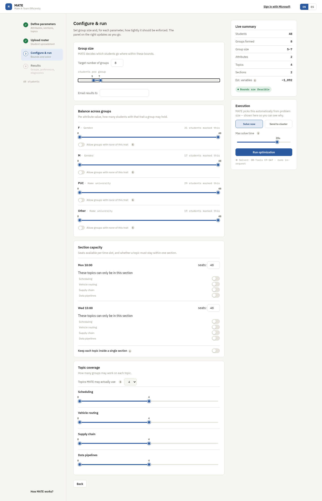
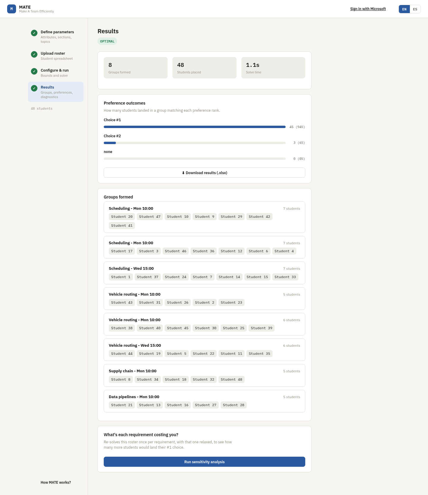

# MATE: Make A Team Efficiently

[](https://github.com/nlvargas/MATE/actions/workflows/ci.yml)
[](LICENSE)

MATE is a web app that splits a class into project groups. An instructor
uploads a spreadsheet with the students, sets the rules (how many groups,
how big, what has to be balanced) and MATE solves an optimization model to
find the assignment that gives students the project topics they ranked
highest while meeting every rule.

<p align="center">
  
  
</p>

## How it works

The app is a four-step wizard:

1. **Setup.** Define the student attributes to balance (gender, home
   university, major...), the class sections or time slots, and the
   project topics students will rank. MATE generates an Excel template
   with matching columns.
2. **Upload.** Fill in the template and upload it. MATE shows a summary of
   the roster: attribute split, section availability and how topic
   preferences are distributed.
3. **Configure & run.** Choose the number of groups, the allowed group
   size, how tightly each attribute must be balanced, section capacities
   and topic coverage. Settings that can't possibly work (say, 20 groups
   of 5 to 7 people for a class of 48) are flagged before anything is
   sent to the solver.
4. **Results.** Get the groups, how many students landed their first or
   second choice, and a one-click Excel download.

## The optimization model

Group assignment is solved as a mixed-integer program. Every student goes
to exactly one group, each group has a topic and a section, and all the
instructor's rules hold at once: group size, section capacity, attribute
balance and topic coverage. The objective minimizes how far students land
from their top-ranked topics, with a heavy penalty on whichever kind of
student ends up worst off, so the solver doesn't sacrifice a few people
to improve the average.

A few things make it practical at real class sizes:

- **Student types.** Students with identical attributes, availability and
  preferences are interchangeable, so the model works with one variable
  per (type, group) instead of one per (student, group). This shrinks the
  model considerably before the solver sees it.
- **Warm start.** A fast greedy heuristic builds an initial assignment
  and hands it to the solver as a starting point, cutting solve time by
  about 23% on 400-student instances.
- **Infeasibility diagnosis.** When the rules can't all be met, MATE
  re-solves with one group of constraints relaxed at a time and tells the
  instructor which specific rule is the problem.
- **Sensitivity analysis.** After a successful solve, the same technique
  shows which rule is costing the most first-choice placements, for
  example how many more students would get their top topic if the gender
  balance were relaxed.
- **Two solve paths.** Small and medium rosters are solved in seconds with
  Google OR-Tools CP-SAT directly in the request. Large ones are sent to a
  university compute cluster running Gurobi, and the results arrive by
  email.

The full formulation (sets, variables, constraints and objective),
benchmarks and design decisions are in
**[docs/ARCHITECTURE.md](docs/ARCHITECTURE.md)**. A step-by-step
[demo](docs/demo/README.md) shows a full run on a 48-student class.

## Stack

| Layer | Technology |
|---|---|
| Optimization | Google OR-Tools (CP-SAT), Gurobi |
| Backend | Python, Django, Django REST Framework |
| Frontend | React, Webpack |
| Hosting | AWS Lambda, API Gateway and S3, deployed with Zappa |
| CI | GitHub Actions: Django checks, solver tests, frontend lint and build |

## Running locally

You need Python 3.10+ and Node 18+.

### 1. Backend

```bash
cd code/client
python3 -m venv .venv
source .venv/bin/activate
pip install -r requirements.txt
cp .env.example .env
python manage.py runserver
```

The defaults in `.env.example` are enough to run locally. The cluster
credentials are only needed for the large-roster path.

### 2. Frontend

In a second terminal:

```bash
cd code/client/frontend
npm install
NODE_OPTIONS=--openssl-legacy-provider npm run build
```

The `NODE_OPTIONS` flag is needed because the project uses Webpack 4,
which predates Node 18's OpenSSL defaults. Use `npm run dev` instead of
`npm run build` for an unminified build while developing; either way,
rebuild after each frontend change.

Then open <http://localhost:8000/>. To try it with sample data, follow
the [demo](docs/demo/README.md) and upload
[`docs/demo/demo_roster.xlsx`](docs/demo/demo_roster.xlsx).

### 3. Tests

```bash
# Solver and model tests (from code/client, with the venv active)
pip install -r requirements-dev.txt
pytest backend/tests/test_model_solving.py backend/tests/test_postprocessing.py -v

# Cluster-side preprocessing tests
cd ../cluster
python3 -m venv .venv && source .venv/bin/activate
pip install -r requirements-dev.txt
pytest tests/ -v
```

To test the whole request path against a running server (local or
deployed), there's an end-to-end smoke test that uploads a synthetic
50-student roster and checks everyone gets placed:

```bash
cd code/client
pip install -r backend/tests/requirements-e2e.txt
python3 backend/tests/e2e_smoke_test.py --base-url http://localhost:8000/dev
```

## Deployment

The app runs on AWS Lambda. See [docs/DEPLOYMENT.md](docs/DEPLOYMENT.md).

## License

[MIT](LICENSE)
