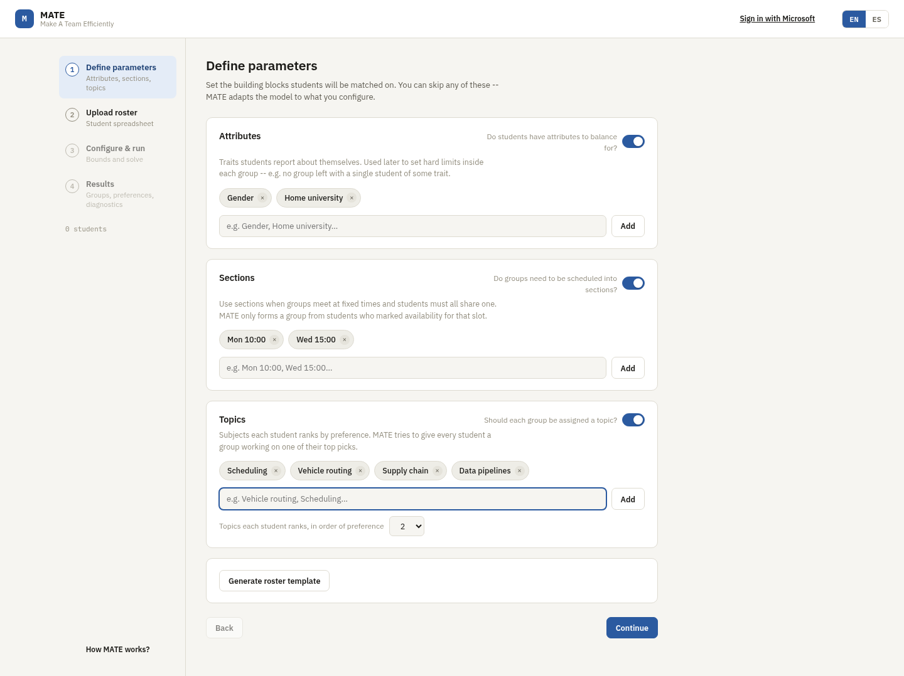
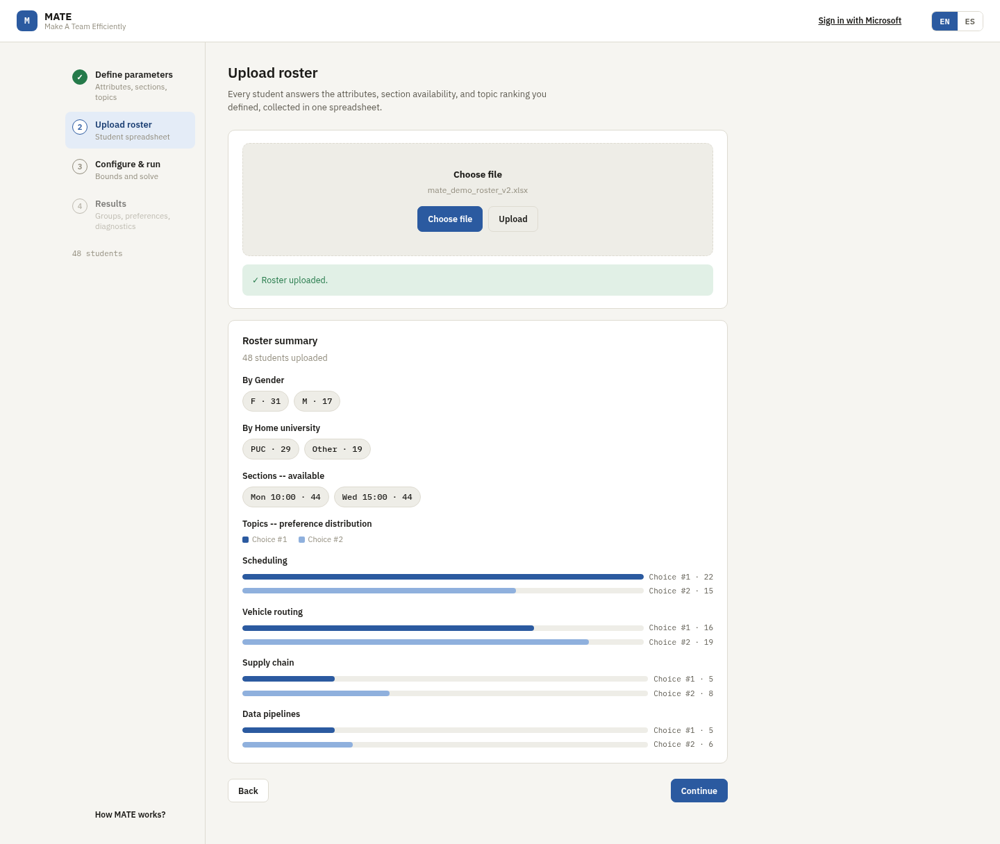
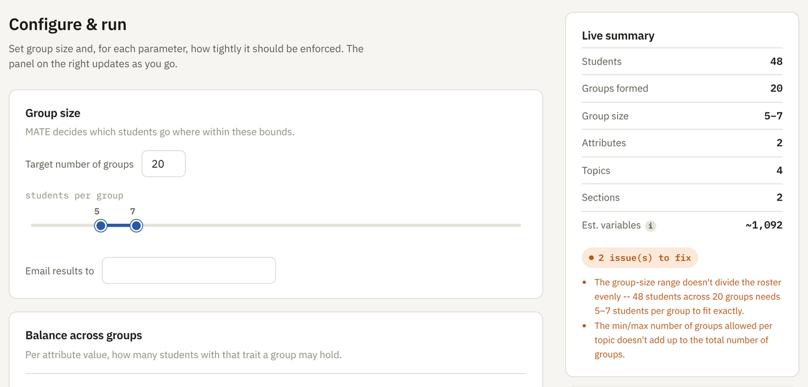
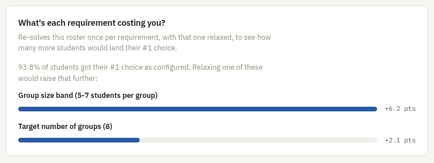

# Demo

A walkthrough of MATE forming 8 project groups for a class of 48 students.
Every screenshot was taken from the running app. To reproduce it yourself,
start the app locally (see the [README](../README.md#running-locally))
and use [`demo_roster.xlsx`](assets/demo_roster.xlsx), a roster of 48 fictional
students.

## Settings

| Step | Setting | Value |
|---|---|---|
| Setup | Attributes | `Gender`, `Home university` |
| Setup | Sections | `Mon 10:00`, `Wed 15:00` |
| Setup | Topics | `Scheduling`, `Vehicle routing`, `Supply chain`, `Data pipelines` |
| Setup | Preferences ranked per student | `2` |
| Configure & run | Number of groups | `8` |
| Configure & run | Group size | `5` to `7` |

Add the attributes, sections and topics in the order shown. The roster's
columns are read by position (name, then attributes, then section
availability, then ranked preferences), so the order has to match the
file. Everything else on the Configure & run screen stays at its default.

## 1. Setup

Define what describes each student and what the groups are formed
around. MATE can also generate an empty Excel template with these exact
columns; `demo_roster.xlsx` follows that template.

## 2. Upload

After the upload MATE summarizes the roster: 31 F and 17 M, 29 students
from PUC and 19 from other universities, availability per section and how
topic preferences are distributed. Preferences lean toward Scheduling and
Vehicle routing on purpose, so not everyone can get their first choice.

## 3. Configure & run

With 8 groups of 5 to 7 students the configuration is feasible, and the
summary panel confirms it before anything is sent to the solver. A roster
this size is solved directly in the request with OR-Tools CP-SAT.

If the configuration can't work, the panel says so before the solver
runs. Changing the number of groups to `20` while keeping groups of 5 to
7 students blocks the run: 20 groups of at least 5 students need 100
people and the class has 48. The panel also flags that the topic limits
(at most 4 groups per topic, 4 topics) can't add up to 20 groups.

## 4. Results

The solver finds a proven optimal assignment in 1.1 seconds. All 48
students are placed in 8 groups: 45 (94%) get their first choice and the
other 3 their second. Each group card shows its topic, section and
members, and the full assignment can be downloaded as an Excel file.

## 5. Sensitivity analysis

The sensitivity analysis re-solves the same roster once per requirement,
relaxing one at a time, to show what each requirement costs. Here 93.8% of
students already get their first choice. Relaxing the group size range
would add 6.2 percentage points and relaxing the number of groups 2.1,
while attribute balance, topic coverage and section capacity cost nothing.
