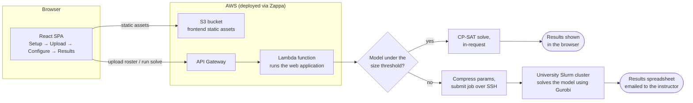
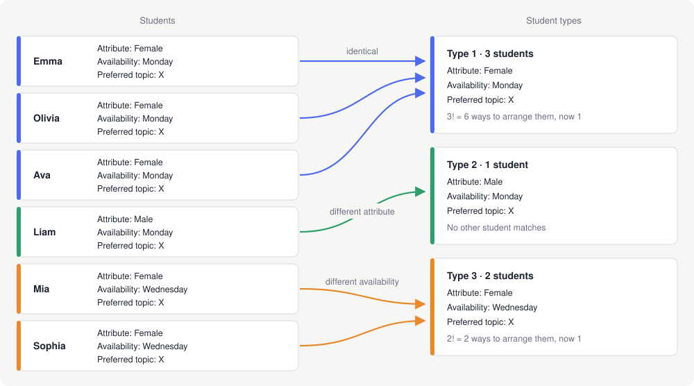
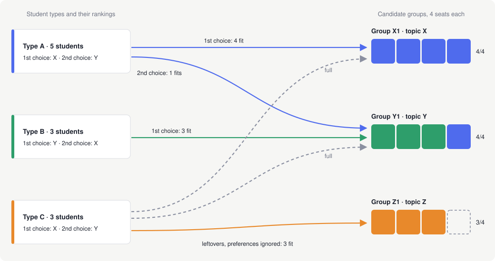

# MATE Technical Overview

MATE ("Make A Team Efficiently") splits a roster of students into balanced
groups. This document describes how it's built, why the model is shaped the
way it is, and how a request actually flows through the system.

## Contents

1. [Overview](#1-overview)
2. [Stack](#2-stack)
3. [Architecture diagram](#3-architecture-diagram)
4. [The model](#4-the-model)
5. [The greedy warm-start heuristic](#5-the-greedy-warm-start-heuristic)
6. [Sensitivity analysis](#6-sensitivity-analysis)
7. [Demo](#7-demo)

## 1. Overview

Instructors regularly need to split a class into project groups subject to
constraints that fight each other: balance gender/university/major across
groups, make sure a group's students all share a free time slot, and give
students a fair shot at the project topics they actually ranked highly. Doing
this by hand for a few dozen students is tedious; doing it well for a few
hundred is effectively impossible without solving an optimization problem.

MATE turns that problem into a constrained-optimization model: given a
roster (with each student's attributes, section availability, and ranked
topic preferences) and a set of instructor-configured bounds, find a group
assignment that satisfies every hard constraint (group size, section
capacity, attribute balance, topic coverage) while minimizing how far
students land from their top preferences. An instructor uses a four-step
wizard (Setup → Upload → Configure & run → Results) to define the problem
and gets back either a solved roster in-browser or, for large problems, an
emailed spreadsheet once a compute cluster finishes the solve.

## 2. Stack

| Layer | Technology |
|---|---|
| Backend | Django + Django REST Framework |
| Frontend | React 16, hand-rolled Webpack 4 (no Create React App) |
| Optimization core (sync/in-request path) | Google OR-Tools CP-SAT |
| Optimization core (async/cluster path) | Gurobi, an independently maintained implementation of the same formulation |
| Hosting | AWS Lambda + API Gateway + S3 (static), via Zappa |
| Large-job compute | PUC university Slurm cluster, driven over SSH/SCP (paramiko) |

## 3. Architecture diagram



After upload, MATE estimates how many decision variables the model will
have and uses that number to pick a solve path. Variable count, not
headcount, is what drives solve time: the same number of students can
produce very different models depending on how many distinct student
types, topics and sections there are (see Preprocessing in §4). Models
under a size threshold are solved with CP-SAT inside the request, and the
results go straight back to the browser. Larger ones are sent to the
university cluster, solved with Gurobi, and the results arrive by email as
a spreadsheet. Before any of this, the browser checks the parameters
against a set of feasibility rules (see Pre-flight feasibility checks in
§4), so a configuration that can't possibly work never reaches the server.

**Time limit and optimality gap.** If the time budget runs out before
CP-SAT proves optimality, the result is reported as FEASIBLE instead of
OPTIMAL, and the Results screen shows the optimality gap: how far, at
most, the solution could be from the best possible one. The gap is
measured on the full objective (preferences plus the balance penalty), so
it isn't the same as the share of students who got their first choice.

## 4. The model

MATE poses group assignment as a mixed-integer program: for every candidate
group, decide how many students of each type it receives, subject to
group-size, section-capacity, attribute-balance, and topic-coverage
constraints, while minimizing how far students land from their top-ranked
topics. It reasons over student types rather than individual students,
which is what keeps the model tractable at real roster sizes. Both solver
backends, CP-SAT for the in-request path and Gurobi for the cluster path,
implement the identical formulation below.

### Preprocessing: student types instead of one variable per student

A naive formulation gives every (student, group) pair its own binary
variable. Students with identical attributes, topic preferences and
section availability are interchangeable, though, so a solver working
student by student wastes time on assignments that only differ in which
of those students went where.

MATE groups them into **student types** before building the model. Two
students are the same type when they share attributes, preferences and
availability, and the model then uses one integer variable per (type,
group) that counts how many students of that type land in the group.



In this example the assignment variables drop from $6 \times |G|$ to
$3 \times |G|$. On a real roster the reduction depends on how many
students look alike, and it shrinks both the model and the symmetry the
solver has to deal with. After solving, each type's count is expanded back
into actual students. Since students of a type are interchangeable, which
one goes to which of the type's groups doesn't change the solution's
quality.

### Sets

| Notation | Meaning |
|:---:|---|
| $I$ | student types |
| $NA \subseteq I$ | types with unknown/unanswered preferences |
| $R$ | attribute *values* (e.g. a specific gender or home university) |
| $G$ | candidate groups (topic × section slot) |
| $T$ | topics |
| $M$ | sections/time-slots |
| $G_t$, $G_m$, $G_{tm}$ | groups by topic / by section / by topic-and-section |

### Decision variables

| Variable | Domain | Meaning |
|:---:|:---:|---|
| $y_{i,g}$ | $\mathbb{N}$ | how many students of type $i$ are assigned to group $g$ |
| $w_g$ | $\lbrace 0, 1 \rbrace$ | 1 if group $g$ has any student assigned |
| $z_i$ | $\mathbb{N}$ | total priority cost accumulated by type $i$'s assignment |
| $z_{max}$ | $\mathbb{N}$ | the worst (highest) $z_i$ across all types (the worst-off student type) |
| $q_{g,r}$ | $\mathbb{N}$ | how many students with attribute value $r$ end up in group $g$ |
| $p_{g,r}$ | $\lbrace 0, 1 \rbrace$ | 1 if group $g$ has *zero* students with attribute value $r$ (only used when $r$ is configured "solo": no group may have none of this trait) |
| $m_g$ | $\mathbb{N}$ | how many students of unknown preference end up in group $g$ |
| $m_{max}$ | $\mathbb{N}$ | the worst (highest) $m_g$ across all groups |
| $u_{t,m}$ | $\lbrace 0, 1 \rbrace$ | 1 if topic $t$ is assigned into section $m$ |
| $o_t$ | $\lbrace 0, 1 \rbrace$ | 1 if any group is actually formed for topic $t$ |

### Restrictions

**Headcount conservation.** Every student type's full headcount $R_i$ is
placed somewhere:

```math
\sum_{g} y_{i,g} = R_i \qquad \forall i \in I
```

**Group activation.** A group can only hold students if it's active:

```math
y_{i,g} \le Q_{max} \cdot w_g \qquad \forall i \in I,\ g \in G
```

**Target group count.** Exactly the requested number of groups, $K$, is
formed:

```math
\sum_{g} w_g = K
```

**Group-size band.** An active group's headcount sits inside the
configured band:

```math
Q_{min} \cdot w_g \le \sum_{i} y_{i,g} \le Q_{max} \cdot w_g \qquad \forall g \in G
```

**Topic coverage.** Each topic gets between a configured minimum and
maximum number of active groups (the minimum only applies when every
configured topic is required to be used). A separate cap limits how many
distinct topics get used at all, so a deployment can offer more topics
than it commits to running.

**Attribute balance.** For a configured attribute value, an active
group's headcount of that value sits inside a configured band. For a
value flagged "solo", a group instead has either none of it or at least
the configured minimum, ruling out a token handful.

**Section capacity.** Total students in a given time slot, across all of
its groups, can't exceed that slot's configured seats.

**Section availability** (structural). A student type can only be placed
into a group whose section it marked itself available for.

**Same-section topics** (optional). A topic can be limited to at most one
section, and specific topic/section combinations can be turned off
entirely.

**Unranked-preference concentration.** A group with more than a small
tolerance of students whose preference is unknown isn't hard-capped. The
overflow is tracked through $m_g$ and $m_{max}$ and penalized in the
objective, so it's discouraged rather than forbidden.

### Objective

```math
\min \sum_i N_i z_i + W \cdot z_{max} + W \cdot m_{max}
```

$N_i$ is a type's total section availability (how many of the configured
sections that type's students can actually attend), computed once during
preprocessing. $W$ is a single large fixed weight, shared by both penalty
terms and chosen to dominate the first term for any roster the model is
meant to handle. The first term minimizes total assigned priority
(topic-preference mismatches, weighted by how flexible a type's schedule
is), and the $W$ terms heavily penalize whichever student type is worst
off ($z_{max}$) and whichever group ends up with the most students of
unknown preference ($m_{max}$), so the solver won't trade one badly served
type for a slightly cheaper average across everyone else.

This is the built-in tension of the problem. Every rule an instructor adds
(attribute balance, group size, topic capacity, shared time slots) shrinks
the set of valid assignments, and with it the room to give each student
their first choice. Within what's left there is a second trade-off, between
a better average and protecting the worst-off students, and the objective
settles it in favor of the worst-off. [Section 6](#6-sensitivity-analysis)
measures how much of the first tension each rule is responsible for.

### Pre-flight feasibility checks

Several restrictions, combined with the request's own numbers, can prove
a configuration infeasible before any model is built. These checks run in
the browser, live, as the Configure & run parameters change. Each one is a
sufficient condition for infeasibility, so when one fires, no assignment
can work regardless of solver, time budget or hardware. Running them in
the UI keeps doomed configurations away from the solver and tells the
person editing a bound right away which values are workable. They only
read configured parameters (headcounts, bounds, capacities), since no
decision variables exist yet. Passing every check doesn't guarantee feasibility,
though; only the solve itself can. The checks live only in the browser, so
the same logic isn't maintained in both Python and JavaScript.

**Section availability.** A type unavailable for every section would get
no $y_{i,g}$ variables at all, making its headcount conservation
$0 = R_i$. With $a_{i,d} = 1$ when type $i$ is available for section $d$,
every type needs at least one section:

```math
\sum_{d \in M} a_{i,d} \ge 1 \qquad \forall i \in I
```

This one was found twice while benchmarking the synchronous-solve
threshold: a single synthetic student with no available section made a
whole roster infeasible.

**Target group count vs. candidate groups.** There can't be more groups
than candidate group slots:

```math
K \le |G|
```

**Group-size band vs. total roster.** Exactly $K$ groups are active, each
with between $Q_{min}$ and $Q_{max}$ students, so the whole roster has to
fit in that band scaled by $K$:

```math
K \cdot Q_{min} \le \sum_{i} R_i \le K \cdot Q_{max}
```

**Attribute balance vs. total headcount.** For a non-solo band
$[min_r, max_r]$ on attribute value $r$, with $I_r$ the types carrying
that value, the roster's total headcount with that value has to fit the
band scaled by $K$:

```math
K \cdot min_r \le \sum_{i \in I_r} R_i \le K \cdot max_r
```

Solo bounds are excluded because each group can opt out of them through
$p_{g,r}$, so no total-headcount check is valid for them.

**Section capacity vs. roster size.** Each section can seat at most the
smaller of its configured seats $C_d$ and the number of students
available for it, and together the sections have to seat everyone:

```math
\sum_{d \in M} \min\Big(C_d,\ \sum_{i \,:\, a_{i,d} = 1} R_i\Big) \ge \sum_{i} R_i
```

**Topic coverage vs. target group count.** Each topic's groups are a
disjoint slice of all groups, so the topics' bands $[min_t, max_t]$ have
to bracket $K$:

```math
\sum_{t \in T} min_t \le K \le \sum_{t \in T} max_t
```

The left inequality only applies when every configured topic is required
to be used.

## 5. The greedy warm-start heuristic

Before the solver starts, a cheap constructive heuristic builds a starting
assignment and hands it to the solver as a hint, so the search begins from
a reasonable point instead of nothing. It works on student types and runs
in two passes:

1. **Preference pass.** Go through the rankings in order, everyone's 1st
   choice first, then everyone's 2nd, and so on. Each type fills groups of
   that topic (in sections it's available for) until they're full.
2. **Fallback pass.** Students who didn't fit in any ranked topic go to
   any group they can attend, ignoring preferences, so the hint is a
   complete assignment.



In the example, type A fills X1 with 4 students and the one left over
fits in Y1, its 2nd choice. Type C finds X1 and Y1 already full, so its 3
students go to Z1, a topic it never asked for, just to complete the
assignment.

The heuristic only respects structural constraints (section availability
and group capacity) and ignores the objective and the balance bounds.
That's fine for a hint: the solver only uses it as a starting point. On
synthetic rosters it made little difference at 150 students, but at 400
it cut mean solve time from about 29 s to about 23 s, with both versions
still proving optimality.

## 6. Sensitivity analysis

After a solve, the natural question is which of the rules is holding the
result back. From the Results screen, MATE answers it by relaxing each rule
on its own and optimizing again. Only the rules whose relaxation improves
the result are listed, with the size of the improvement.

### The idea in plain terms

Think of every rule (group size range, attribute balance, topic coverage,
section capacity) as a fence around the possible assignments. MATE removes
one fence, searches again for the best assignment, and checks whether the
best result got better. If it did, that rule has a cost and the card shows
how much. If it didn't, the rule isn't what limits the result. Because the
solver can prove that no better assignment exists, "no change" is a proof
and not an estimate.

The analysis only runs when asked, since it needs one extra search per rule
and that wouldn't fit in the time budget of every request.

### What the numbers mean

The model's objective judges a result by its worst case: how badly off the
most disadvantaged kind of student is (`1000 * (z_max + M_max)`, plus a
total-mismatch term that matters little next to it). The improvement is
reported in that unit, in points of 1000, so one point is roughly one
student who no longer ends up without any of their choices. We don't report
the share of students who get their 1st choice because the objective
doesn't optimize it: many assignments tie on the objective and differ widely
in that share, so the number would change from run to run.

### How it works

1. The Results screen calls `/run_sensitivity_analysis/` with the same
   request body as the main solve plus the solution it received (each group
   and its student ids). The server rebuilds the model and checks that the
   solution satisfies it, so nothing is solved twice. If the solution is
   missing or doesn't fit the model, the baseline is solved like the main
   solve instead.
2. The unrelaxed model is optimized once from that assignment. When it
   finishes, it gives a proven lower bound on the objective.
3. Each rule is a clone of the model with that rule's constraints widened in
   place. A feasibility solve with the objective capped just below the bound
   asks whether any assignment beats it.
4. If one exists, the rule improves the result, and the search is continued
   from that assignment to measure the gain. If the solver proves none
   exists, the rule changes nothing, provided the bound was tight.
5. Only the rules that improve the result are listed. A rule that couldn't
   be decided, because the baseline wasn't proven optimal or the time budget
   ran out, is counted as unchecked and shown as a count, so the card never
   claims more than was proven.

A linear relaxation of the model only decides the order in which rules are
checked, largest dual value first, so the ones most likely to matter are
decided before the budget runs out.

### Why it re-optimizes instead of reading dual values

In a linear program, the dual values say directly what relaxing a constraint
is worth. In an integer program they don't. The optimal value as a function
of the right-hand side is not a straight line but a piecewise function with
jumps, which is what Blair and Jeroslow (1982) showed and Wolsey (1981)
discusses as price functions. A dual value taken from the relaxation can be
zero for a rule that does cost something.
Re-optimizing answers the question directly.

### Where this comes from

Re-solving a modified model to see how the optimum moves is the standard
form of post-optimality analysis for integer programs, which Geoffrion and
Nauss (1977) survey. Removing one family of constraints at a time and
re-solving is close in spirit to the infeasibility diagnosis of Chinneck and
Dravnieks (1991), which MATE also uses when a configuration has no solution.
Capping the objective and asking for feasibility is a standard way to prove
that nothing better exists.

There are methods that read sensitivity ranges from the solver's own search
tree instead of re-solving (Schrage and Wolsey, 1985; Dawande and Hooker,
2000), but they need access to that tree, which OR-Tools CP-SAT doesn't
expose. Theoretical bounds on how far an integer optimum can move (Cook,
Gerards, Schrijver and Tardos, 1986) depend on the largest subdeterminant of
the constraint matrix and are far too loose for a model of this size. We
haven't found this exact combination described as a single published
method: it puts the pieces above together, with the proof-based reporting
described in step 5.

### References

- Blair, C. E., and Jeroslow, R. G. (1982). The value function of an integer
  program. *Mathematical Programming* 23, 237-273.
- Chinneck, J. W., and Dravnieks, E. W. (1991). Locating minimal infeasible
  constraint sets in linear programs. *ORSA Journal on Computing* 3(2),
  157-168. [doi:10.1287/ijoc.3.2.157](https://doi.org/10.1287/ijoc.3.2.157)
- Cook, W., Gerards, A. M. H., Schrijver, A., and Tardos, E. (1986).
  Sensitivity theorems in integer linear programming. *Mathematical
  Programming* 34, 251-264.
- Dawande, M., and Hooker, J. N. (2000). Inference-based sensitivity analysis
  for mixed integer/linear programming. *Operations Research* 48(4), 623-634.
  [doi:10.1287/opre.48.4.623.12420](https://doi.org/10.1287/opre.48.4.623.12420)
- Geoffrion, A. M., and Nauss, R. (1977). Parametric and postoptimality
  analysis in integer linear programming. *Management Science* 23(5),
  453-466. [doi:10.1287/mnsc.23.5.453](https://doi.org/10.1287/mnsc.23.5.453)
- Schrage, L., and Wolsey, L. (1985). Sensitivity analysis for branch and
  bound integer programming. *Operations Research* 33(5), 1008-1023.
  [doi:10.1287/opre.33.5.1008](https://doi.org/10.1287/opre.33.5.1008)
- Wolsey, L. A. (1981). Integer programming duality: price functions and
  sensitivity analysis. *Mathematical Programming*.
  [doi:10.1007/BF01589344](https://doi.org/10.1007/BF01589344)

## 7. Demo

A step-by-step walkthrough with screenshots and the roster used to
produce them is in [DEMO.md](DEMO.md).
